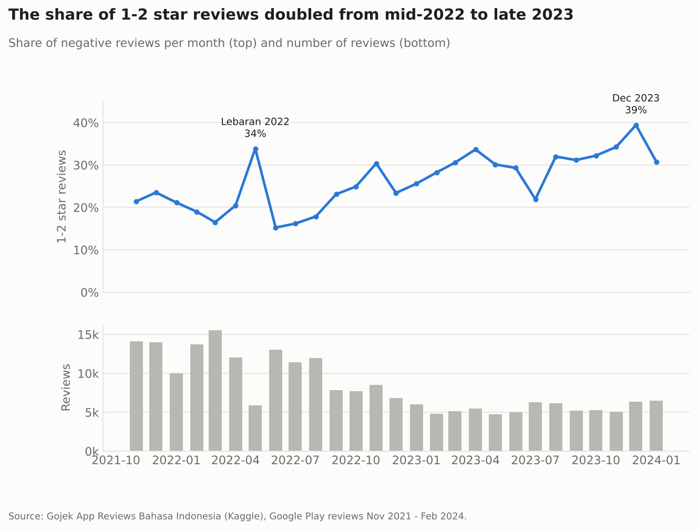
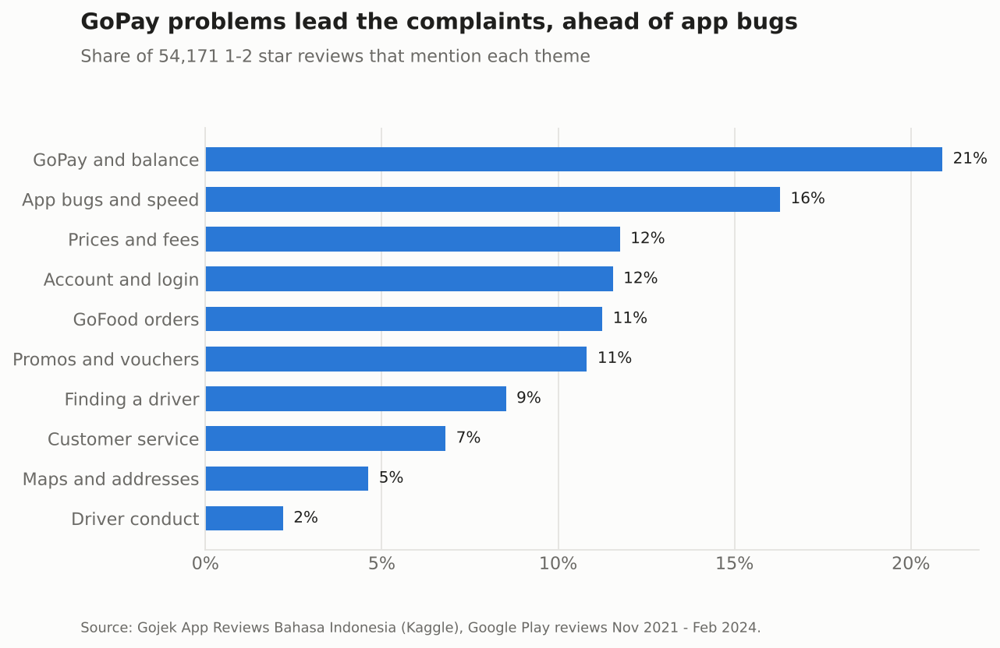
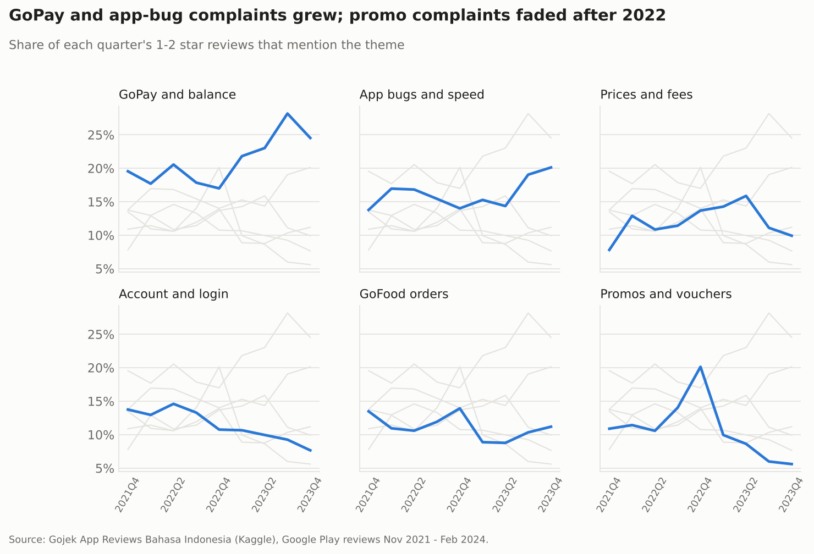
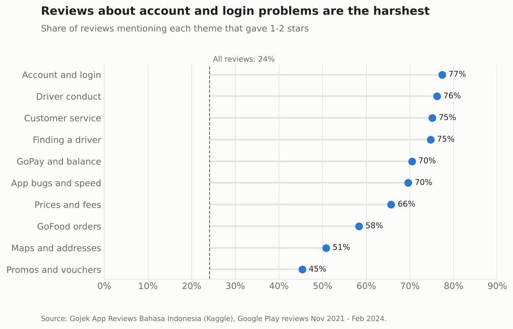
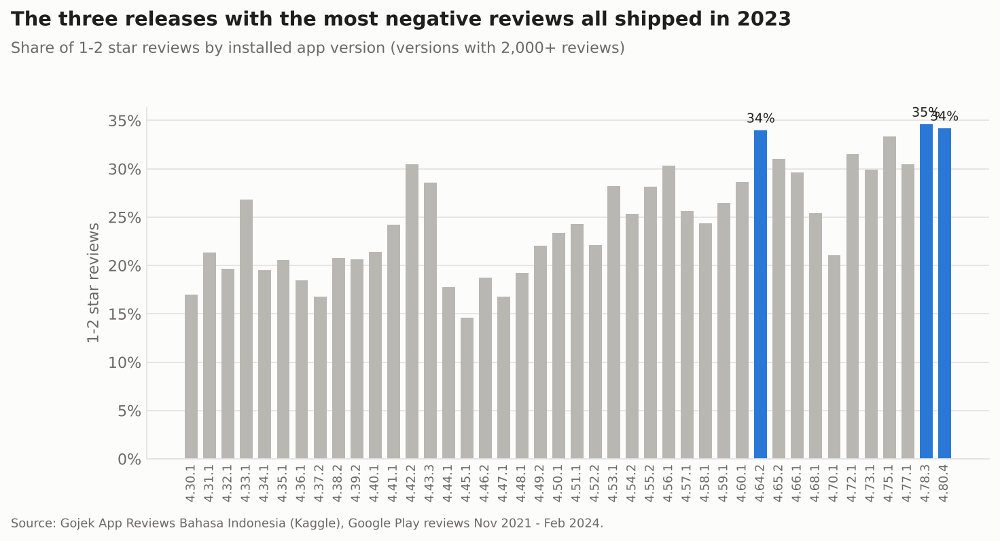

# What Gojek users complain about

An analysis of 225,002 Google Play reviews of the Gojek app, written between November 2021 and February 2024. It tracks how ratings moved, sorts the 54,171 one- and two-star reviews into complaint themes, and checks which app releases drew the most negative reviews.

The full walkthrough with code is in [`notebooks/gojek_reviews.ipynb`](notebooks/gojek_reviews.ipynb).

## Findings

**The share of 1-2 star reviews doubled.** It was 16% in June-August 2022 and 34% in October 2023-January 2024. The average rating fell from 4.23 to 3.53 over the same months. Two months stand out: May 2022, the month of Lebaran, when price and fee complaints jumped from 8% to 14% of negative reviews, and December 2023 at 39%.



**GoPay is the biggest complaint.** Problems with the GoPay balance, top-ups, transfers and PayLater appear in 21% of negative reviews, followed by app bugs and slowness at 16%. About a third of negative reviews name no specific problem ("aplikasi gak jelas", "sampah") and match no theme.



**The mix changed over time.** GoPay complaints grew from 19-20% of negative reviews in late 2021 to 28% in Q3 2023. App-bug complaints rose in the second half of 2023. Promo and voucher complaints peaked at 20% in Q4 2022 and fell to about 6% by the end of 2023.



**Frequent is not the same as severe.** Of all reviews that mention account or login problems (blocked accounts, OTP codes, changing phone numbers), 77% give one or two stars, against 24% for reviews overall. Promos are mentioned often, but 55% of those reviews are 3-5 stars, because users also write about promos they liked.



**Recent releases draw the harshest reviews.** Among versions with at least 2,000 reviews, the three with the highest negative share all shipped in 2023: 4.78.3 (35%), 4.80.4 (34%) and 4.64.2 (34%). Reviews are filed under the version the reviewer had installed, so a version also collects complaints that have nothing to do with the app build, such as fees and driver availability.



## What I would do with this

- Treat GoPay and account access as the first support priorities. They are the largest and the most severe themes respectively, and both block people from using the app at all.
- Track the theme shares monthly next to the release calendar. The jump in app-bug complaints in late 2023 would have been visible within weeks.
- Look at fee communication before peak periods. The May 2022 spike lines up with Lebaran demand.

## Method

- **Themes** are keyword patterns in Indonesian, including slang and common misspellings (`gabisa`, `dapet`, `eror`). The word lists came from the most frequent words and word pairs in negative reviews. They live in [`src/themes.py`](src/themes.py), and a review can match several themes.
- **Coverage**: 69% of negative reviews match at least one theme. I read samples of the unmatched ones; most are short, general complaints without a stated reason.
- **Severity** is the share of 1-2 star reviews among all reviews that mention a theme, compared with the 24% baseline.
- Reviewer names are dropped when the data is loaded.

## Limits

Keyword matching misses sarcasm and unusual spellings. Play Store reviewers are people motivated enough to write a review, not a sample of all users. The data ends in early February 2024.

## Run it

```bash
pip install -r requirements.txt
# download the CSV first, see data/README.md
jupyter notebook notebooks/gojek_reviews.ipynb
```

The notebook writes the charts to `images/` and summary tables to `results/`.

## Layout

```
notebooks/gojek_reviews.ipynb   the analysis
src/themes.py                   complaint themes and the tagging function
src/chart_style.py              shared chart settings
results/                        monthly ratings, theme shares, version table
images/                         charts
```

## Data

[Gojek App Reviews Bahasa Indonesia](https://www.kaggle.com/datasets/ucupsedaya/gojek-app-reviews-bahasa-indonesia) on Kaggle. The data is not redistributed here; see `data/README.md`.
